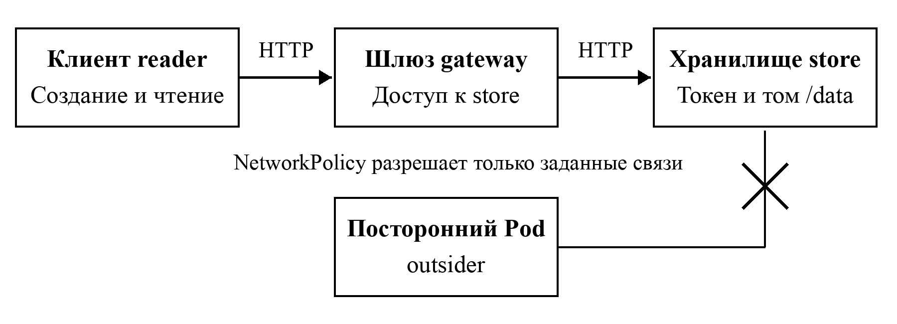

# Безопасность Docker и Kubernetes

Учебный проект Container Security Lab 1.0.0 к статье «Безопасность контейнеров
Docker и Kubernetes». На примере сервиса заметок сравниваются обычные
и усиленные настройки контейнеров. Приложение написано на Python
без сторонних библиотек.

[Полный гайд по запуску, проверкам и публикации на GitHub](docs/GUIDE.md)

[Открыть демонстрацию в браузере](https://archeemage-hub.github.io/container-security-lab/)

В демонстрации можно создавать заметки, сравнивать конфигурации и смотреть
сохранённый протокол 41 проверки. Заметки работают в браузере; ограничения
контейнеров показаны моделью. Настоящий стенд запускается командами ниже.



## Репозиторий и статья

Репозиторий: [archeemage-hub/container-security-lab](https://github.com/archeemage-hub/container-security-lab).
Версия для статьи: [v1.0.0](https://github.com/archeemage-hub/container-security-lab/tree/v1.0.0).
Гайд объясняет запуск, публикацию и оформление библиографического источника № 1. Связь выводов статьи
с результатами приведена в [ARTICLE_MAP.md](evidence/ARTICLE_MAP.md).

В проекте два сервиса: `gateway` принимает запросы, а `store` хранит заметки
в JSON-файле. Для обращения к хранилищу шлюз читает токен из отдельного
файла. В обоих вариантах используется один и тот же образ приложения.

## Файлы проекта

| Файл или папка | Назначение |
|---|---|
| `app/app.py` | Шлюз и хранилище; роль выбирается через `APP_ROLE` |
| `app/probe.py` | Проверка процесса, файловой системы и запросов |
| `Dockerfile` | Сборка общего образа приложения |
| `compose.baseline.yaml` | Обычный запуск в Docker |
| `compose.hardened.yaml` | Запуск в Docker с ограничениями |
| `compose.cluster.yaml` | Локальный узел Kubernetes на K3s |
| `k8s/` | Манифесты двух вариантов, сетевые правила и роли |
| `scripts/deploy.py` | Сборка, создание токена и запуск стенда |
| `scripts/verify.py` | Сравнение вариантов и запись результатов |
| `scripts/update_manifest.py` | Обновление контрольных сумм после изменений |
| `scripts/build_demo.py` | Обновление данных HTML-демонстрации из протокола |
| `evidence/` | Результаты, использованные в статье |
| `docs/GUIDE.md` | Подробная инструкция по работе и публикации |
| `docs/index.html` | Демонстрация для браузера и GitHub Pages |

## Запуск

Нужны Linux x86_64, Docker Engine, Docker Compose, Python 3.10 или новее
и около 3 ГБ свободной памяти для узла K3s. При первом запуске потребуется
Интернет для загрузки образов. Отдельный kubectl устанавливать не нужно.

В каталоге проекта выполните:

```bash
docker pull python:3.12.11-slim-bookworm@sha256:519591d6871b7bc437060736b9f7456b8731f1499a57e22e6c285135ae657bf7
python3 scripts/deploy.py
python3 scripts/verify.py
python3 scripts/build_demo.py
```

Скрипт запускает проекты Compose `csl-baseline`, `csl-hardened`, узел `csl-k3s`
и создаёт пространства имён `article-baseline` и `article-secure`.
Токен хранится в `.runtime/`, не входит в образ и не включён в архив.
Настройки находятся в обычных YAML-файлах и не генерируются скриптом.

Обычный вариант доступен по адресу `http://127.0.0.1:18081/notes`,
усиленный — `http://127.0.0.1:18080/notes`.
GET `/notes` возвращает заметки, POST `/notes` с JSON
`{"text":"Учебная заметка"}` создаёт новую. Ограничения: 160 символов
на заметку, 100 заметок в хранилище и 4096 байт на запрос.

Для просмотра состояния Kubernetes:

```bash
docker exec csl-k3s /bin/kubectl get pods -A
docker exec csl-k3s /bin/kubectl get networkpolicy -n article-secure
```

## Что сравнивается

| Настройка | Обычный вариант | Усиленный вариант |
|---|---|---|
| Пользователь | root | UID/GID 10001 |
| Корневая файловая система | Доступна для записи | Только чтение |
| Linux capabilities | Стандартный набор | Все удалены |
| Повышение привилегий | Не ограничено отдельной настройкой | Запрещено |
| Токен ServiceAccount в Kubernetes | Монтируется | Не монтируется |
| Доступ постороннего Pod к хранилищу | Разрешён | Заблокирован NetworkPolicy |

Для усиленных контейнеров заданы ограничения ресурсов и отдельные каталоги
для данных и временных файлов. В Kubernetes разрешена цепочка
`reader → gateway → store` и DNS; остальные соединения запрещены.
Роль наблюдателя позволяет читать Pod, но не Secrets. Политика Restricted
отклоняет привилегированный Pod до запуска. Шифрование Secrets включено
для всего кластера. Seccomp действует в обоих вариантах Docker.

## Результаты и ограничения

Последний запуск: **41/41 проверок пройдено**. Полные результаты находятся
в `evidence/checks.json`, параметры процессов — в `runtime-snapshots.json`,
сведения о среде — в `environment.json`. Файл `ARTICLE_MAP.md` связывает
эти материалы с выводами статьи. Контрольные суммы перечислены в
`MANIFEST.sha256`.

После изменения файлов обновите суммы командой
`python3 scripts/update_manifest.py`. Проверить их можно командой
`sha256sum -c MANIFEST.sha256`.

Для локального просмотра откройте `docs/index.html` в браузере вместе
с остальными файлами папки `docs`. Установка пакетов для страницы не требуется.
Для публикации GitHub Pages используется ветка `main` и папка `/docs`.

Это локальный учебный стенд. Шлюз не использует TLS и пользовательскую
аутентификацию. В Kubernetes данные `emptyDir` теряются при замене Pod.
Контейнер узла K3s требует privileged; усиленные контейнеры приложения
так не запускаются. Проверка шифрования кратко приостанавливает только
`csl-k3s`, копирует его SQLite/Kine в `.runtime/` и возобновляет работу.
Проверки не включают поиск CVE, атаки на ядро и нагрузочные испытания.

## Остановка

```bash
docker compose -p csl-baseline -f compose.baseline.yaml stop
docker compose -p csl-hardened -f compose.hardened.yaml stop
docker compose -p csl-cluster -f compose.cluster.yaml stop
```

Тома и заметки сохраняются. Для удаления стенда вместе с его данными
замените `stop` на `down -v` в этих трёх командах.
